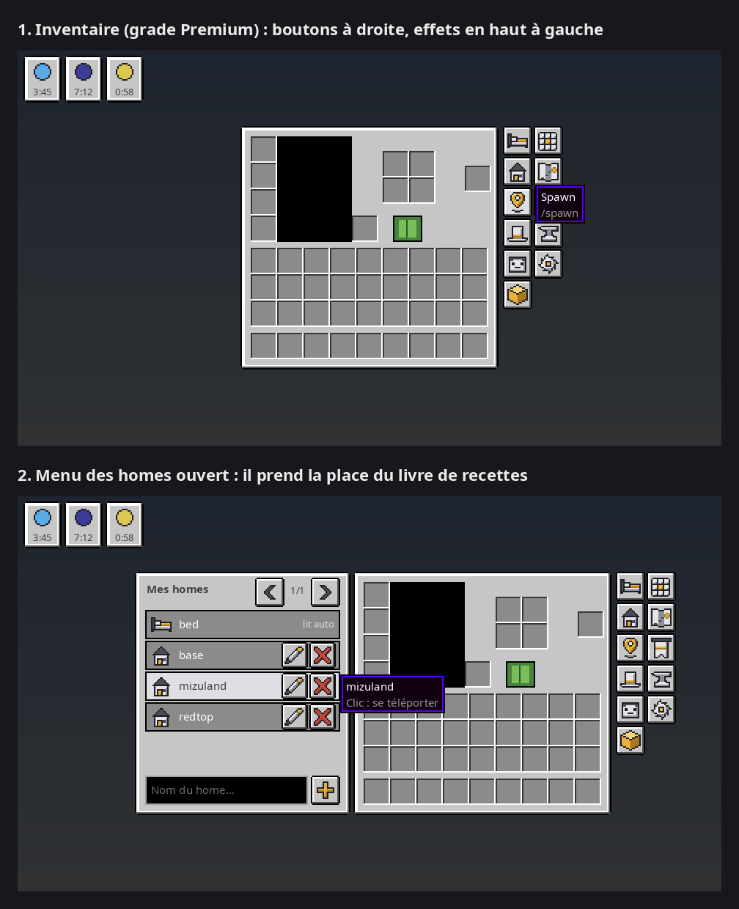

# Grade Menu

Mod Fabric (client) pour Minecraft **26.3** : des boutons dans l'inventaire pour lancer les commandes de grade du serveur sans les taper, et un menu des homes.



## Fonctionnalités

- **Boutons à côté de l'inventaire**, selon le grade choisi. Ils suivent l'inventaire quand le livre de recettes s'ouvre.
  - ₪ Confirmé·e : mon lit (`/home bed`), chapeau (`/hat`), table de craft (`/craft`)
  - ★ Premium : en plus, menu des homes, `/spawn`, `/skull`, `/blocks`, `/cartographytable`, `/loom`, `/smithingtable`, `/stonecutter`
  - `/trash` n'est volontairement **pas** proposé (trop dangereux depuis l'inventaire).
- **Menu des homes** (Premium), à la place du livre de recettes :
  - liste lue avec `/homes` (la réponse est cachée du chat), 5 homes par page ;
  - clic sur un home = téléportation ;
  - renommer (crayon) et supprimer (croix, deuxième clic pour confirmer) ;
  - créer un home depuis le champ du bas ;
  - `bed` (dernier lit, automatique) ne peut être ni renommé ni supprimé.
- **Effets de potion** déplacés en haut à gauche de l'écran d'inventaire (la place de droite est prise par les boutons).
- Les boutons ne s'affichent que sur un serveur, pas en solo.

## Commandes

Toutes les commandes sont locales (rien n'est envoyé au serveur) et commencent par `/grade-`.
Les réglages sont gardés dans `config/grademenu.properties`.

| Commande | Effet |
|---|---|
| `/grade-set joueur\|confirme\|premium` | choisit le grade (donc les boutons affichés) |
| `/grade-position <x> <y>` | décale les boutons : x vers la droite, y vers le haut (en pixels d'interface) |
| `/grade-position reset` | remet les boutons à leur place d'origine |
| `/grade-bouton` | liste les boutons, avec des liens [masquer] / [afficher] |
| `/grade-bouton <bouton> on\|off` | affiche / masque un bouton (gardé même en changeant de grade) |
| `/grade-bouton reset` | ré-affiche tous les boutons |

Noms des boutons : `home`, `homes`, `spawn`, `hat`, `skull`, `blocks`, `craft`, `cartographytable`, `loom`, `smithingtable`, `stonecutter`.

## Installation

Prérequis : Minecraft 26.3, Fabric Loader ≥ 0.20.1, Fabric API, Java 25.

Copier `build/libs/grade-menu-<version>.jar` dans le dossier `mods` du profil.

## Compiler

```sh
./gradlew build        # jar dans build/libs/, lance aussi les tests
```

Les icônes (pixel art 16×16) et les fonds d'interface sont générés par un script Python (Pillow) :

```sh
cd icones && python3 generer_icones.py   # écrit png/, widgets/ et apercu.png
```

Le build copie `icones/png` et `icones/widgets` dans les ressources du mod.

## Licence

MIT
